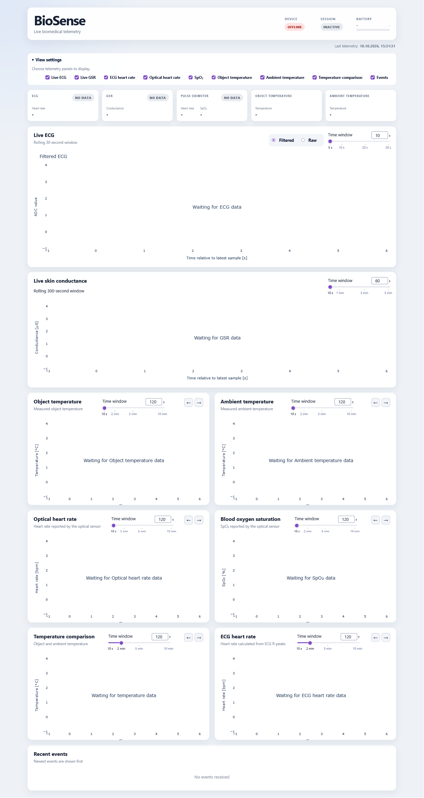

# Biosense-Platform

BioSense Platform collects biomedical telemetry from a BioSense device over MQTT. It provides a live dashboard and saves measurement sessions locally.

## Features

- Receives device status, metrics, events, ECG samples, and GSR samples over MQTT.
- Displays live ECG and skin conductance data, heart rate, SpO₂, and temperature.
- Shows device and sensor status, battery level, and session information.
- Saves session data as CSV files with a JSON metadata file.

## Dashboard



## Requirements

- Python 3.10 or newer
- Access to an MQTT broker used by the BioSense device

## Setup

Clone the repository and install the Python dependencies:

```bash
git clone https://github.com/KrystianRuszczak/BioSense-Platform.git
cd BioSense-Platform
python -m venv .venv
```

Activate the virtual environment:

```bash
# Windows (Git Bash)
source .venv/Scripts/activate

# macOS / Linux
source .venv/bin/activate
```

Install dependencies and create a local configuration file:

```bash
pip install -r requirements.txt
cp .env.example .env
```

Edit .env and enter the MQTT broker and device credentials:

```bash
MQTT_BROKER=your_broker_hostname
MQTT_PORT=8883
MQTT_USERNAME=your_username
MQTT_PASSWORD=your_password
MQTT_DEVICE_ID=your_device_id
```

Keep .env private. It contains local credentials and should not be committed.

## Run

Start the collector and dashboard from the repository root:

```bash
python -m collector
```

The dashboard is available at http://127.0.0.1:8050.

Stop the application with Ctrl+C.

## Session data

When a measurement session is active, the platform creates a directory under data/sessions/. Each session contains:

- metrics.csv - device metrics
- events.csv - session events
- ecg.csv - ECG samples
- gsr.csv - GSR samples
- metadata.json - session metadata and data integrity information
Session data is stored locally and is not included in the repository.

## License

See the LICENSE file for license terms.
